<picture>
  <source media="(prefers-color-scheme: dark)" srcset="assets/hero-dark.svg">
  
</picture>

  <a href="https://faizkhan.tech">faizkhan.tech</a> &nbsp;/&nbsp;
  <a href="https://www.linkedin.com/in/faizk5">linkedin</a> &nbsp;/&nbsp;
  <a href="mailto:faizedu3@gmail.com">email</a> &nbsp;/&nbsp;
  <a href="https://faizkhan.tech/Faiz-Khan-Resume.pdf">résumé</a>

<picture>
  <source media="(prefers-color-scheme: dark)" srcset="assets/map-dark.svg">
  
</picture>

  

<picture>
  <source media="(prefers-color-scheme: dark)" srcset="assets/specimen-dark.svg">
  
</picture>

<a href="https://github.com/ifaizk5/healthcare-ai">open the HealthLens repo →</a>

<picture>
  <source media="(prefers-color-scheme: dark)" srcset="assets/bench-dark.svg">
  
</picture>

  <a href="https://btbt.vercel.app">btbt store</a> ·
  <a href="https://github.com/ifaizk5/faiz-khan-mern-10pshine">Noteify</a> ·
  <a href="https://github.com/ifaizk5/portfolio">faizkhan.tech source</a> ·
  <a href="https://ifaizk5.github.io/NFT_Site/">NFT site</a> ·
  <a href="https://ifaizk5.github.io/rappi/">Rappi</a> ·
  <a href="https://ifaizk5.github.io/neoFi/">neoFi</a> ·
  <a href="https://github.com/ifaizk5/Interee.pk-Clone">Internee.pk</a>

 

<picture>
  <source media="(prefers-color-scheme: dark)" srcset="assets/buildlog-dark.svg">
  
</picture>

<picture>
  <source media="(prefers-color-scheme: dark)" srcset="assets/box-dark.svg">
  
</picture>

<picture>
  <source media="(prefers-color-scheme: dark)" srcset="assets/signoff-dark.svg">
  
</picture>

plain text

Faiz Khan is a software engineer from Pakistan (BS Software Engineering, SZABIST 2026) who works across interfaces, backends, machine learning and cloud deployment. Experience: ZETSOL Technologies (backend trainee engineer, NestJS and PostgreSQL), 10Pearls (MERN intern), Grands Digital (web development intern). Currently building HealthLens, a healthcare ML playground. Also: published research on Mixed Reality Compositing on Meta Quest 3, IT Officer for IEEE SZABIST, Aspire Leaders Program, 18 certifications.

Open to software engineering roles: [faizkhan.tech](https://faizkhan.tech) · [faizedu3@gmail.com](mailto:faizedu3@gmail.com) · [LinkedIn](https://www.linkedin.com/in/faizk5)

The build log and language label are regenerated daily by a GitHub Action in this repo (`scripts/render.mjs`); if a run fails, the last generated images stay in place.

