<picture>
  <source media="(prefers-color-scheme: dark)" srcset="assets/hero-dark.svg">
  
</picture>

  <a href="https://faizkhan.tech"><b>Portfolio</b></a> &nbsp;·&nbsp;
  <a href="https://www.linkedin.com/in/faizk5">LinkedIn</a> &nbsp;·&nbsp;
  <a href="mailto:faizedu3@gmail.com">Email</a> &nbsp;·&nbsp;
  <a href="https://faizkhan.tech/Faiz-Khan-Resume.pdf">Résumé</a>

 

<picture>
  <source media="(prefers-color-scheme: dark)" srcset="assets/whoami-dark.svg">
  
</picture>

  

<!-- Cards use <picture> for theme switching; GitHub splits a <picture> placed inside a link, so links sit in the row below. -->
<picture><source media="(prefers-color-scheme: dark)" srcset="assets/work-fairvision-dark.svg"></picture>
<picture><source media="(prefers-color-scheme: dark)" srcset="assets/work-safezone-dark.svg"></picture>
<picture><source media="(prefers-color-scheme: dark)" srcset="assets/work-noteify-dark.svg"></picture>
<picture><source media="(prefers-color-scheme: dark)" srcset="assets/work-portfolio-dark.svg"></picture>

  <a href="https://faizkhan.tech/#work">FairVision &amp; SafeZone on faizkhan.tech ↗</a> &nbsp;·&nbsp;
  <a href="https://github.com/ifaizk5/faiz-khan-mern-10pshine">Noteify repo ↗</a> &nbsp;·&nbsp;
  <a href="https://github.com/ifaizk5/portfolio">Portfolio repo ↗</a>

  

<picture>
  <source media="(prefers-color-scheme: dark)" srcset="assets/route-dark.svg">
  
</picture>

  

<picture>
  <source media="(prefers-color-scheme: dark)" srcset="assets/toolkit-dark.svg">
  
</picture>

  

<picture>
  <source media="(prefers-color-scheme: dark)" srcset="assets/learning-dark.svg">
  
</picture>

  

<picture>
  <source media="(prefers-color-scheme: dark)" srcset="assets/signoff-dark.svg">
  
</picture>

Plain-text version

**Faiz Khan** is a software engineer from Pakistan and a 2026 BS Software Engineering graduate of SZABIST, open to software engineering roles across frontend, backend and cloud. He has published research on Mixed Reality Compositing on Meta Quest 3, served as IT Officer for the IEEE SZABIST student branch, took part in the Aspire Leaders Program, and holds 18 certifications including Stanford Online's Supervised Machine Learning.

- **Experience:** Backend trainee engineer at ZETSOL Technologies (NestJS, PostgreSQL, Drizzle ORM), MERN intern at 10Pearls, web development intern at Grands Digital, IT Officer for the IEEE SZABIST student branch.
- **Projects:** FairVision (dataset bias detection), SafeZone (secure incident-reporting backend), Noteify (MERN notes app), and [faizkhan.tech](https://faizkhan.tech).
- **Contact:** [faizedu3@gmail.com](mailto:faizedu3@gmail.com) · [LinkedIn](https://www.linkedin.com/in/faizk5)

